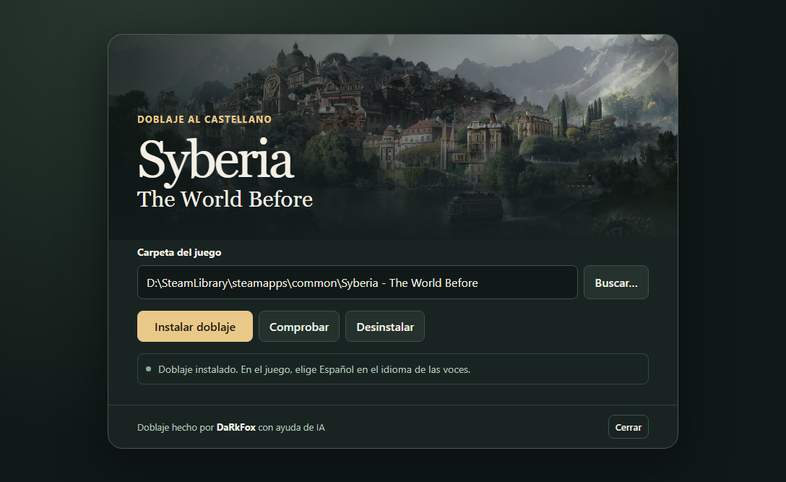

# Syberia: The World Before · Doblaje al castellano

Doblaje hecho por DaRkFox con ayuda de IA.



El parche usa los archivos de la edición de Steam, compilación 8987614. Descarga `Syberia-Castellano.zip` y el instalador de tu plataforma desde [Releases](https://github.com/darkfoxdeveloper/SyberiaTWBSpanishDubbing/releases/latest). Cierra Syberia y guarda ambos archivos juntos. Deja el ZIP sin descomprimir.

Si ya instalaste una edición del doblaje, pulsa **Desinstalar** con el ZIP de esa edición antes de instalar esta actualización. La edición corregida incorpora los audios que el motor Wwise del juego puede reproducir.

## Windows 11

Abre `Instalar-Syberia.exe`. El instalador se abre en el navegador. Selecciona la carpeta que contiene `SyberiaTWB.exe` si Steam no la detecta automáticamente y pulsa **Instalar doblaje**.

## Steam Deck

1. Cierra Syberia y cambia al **modo Escritorio**.
2. Abre en Dolphin la carpeta que contiene `Instalar-Syberia-SteamDeck` y `Syberia-Castellano.zip`. Deja el ZIP sin descomprimir.
3. Pulsa **F4** para abrir la terminal en esa carpeta y ejecuta:

   ```sh
   chmod +x ./Instalar-Syberia-SteamDeck
   ./Instalar-Syberia-SteamDeck
   ```

   Si el archivo ya tiene permiso de ejecución, basta con la segunda línea. Usa esta ruta si el doble clic abre Discover. Con Steam abierto, **STEAM + X** muestra el teclado en pantalla.

4. El instalador se abre en el navegador. Si el navegador no abre solo, copia la dirección `http://127.0.0.1:…` completa que muestra la terminal y ábrela manualmente. Deja la terminal abierta mientras se instala el parche.
5. Pulsa **Instalar doblaje**. Si el instalador no detecta la carpeta del juego, encuéntrala en **Steam → Syberia → Gestionar → Explorar archivos locales** y elige la carpeta que contiene `SyberiaTWB.exe`.

También puedes instalar desde la terminal con `./Instalar-Syberia-SteamDeck instalar` y pegar la ruta de esa carpeta cuando te la pida.

## En el juego

Entra en **Opciones → Sonido → Idioma del doblaje** y elige **Español**. El idioma del texto se elige en la fila siguiente. El vídeo **Anteriormente** también usa el idioma del doblaje. Para restaurar el juego, vuelve a abrir el instalador y pulsa **Desinstalar**.

Si cambias el idioma de las voces durante una partida, vuelve al menú principal y carga la partida para actualizar también las voces de ambiente.

La actualización incluye conversaciones y llamadas de fondo en el concierto, la mina y la cafetería. Se mezclaron las voces en castellano con el sonido de fondo de cada grabación.

Ilustración de Vaghen del material oficial de Microids incluido con el juego.

## Código fuente

El código fuente está en [`src/`](src/README.md). Incluye el [instalador para Windows y Steam Deck](src/installer/), el [selector de voces en español](src/selector/) y el [exportador del parche Wwise](src/exporter/).

En la [guía de compilación](src/README.md) están los comandos y los archivos locales que necesita el exportador.
